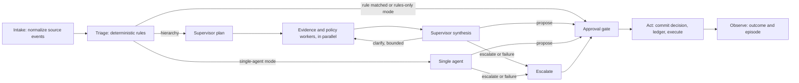

# Architecture

## Case flow

The graph runs on LangGraph with a SQLite checkpointer, so an interrupted run resumes from its
last completed node. The approval gate has no side effects before it pauses; `act` commits the
decision (the first committed decision per run wins), checks approval again, and executes
through the ledger.

## Layers and boundaries

| Layer | Responsibility |
|---|---|
| Events | Source vocabularies mapped to canonical events through versioned YAML; unmapped events are rejected |
| Simulation | Synthetic worlds with hidden ground truth; the engine sees only the observable view as of a given time |
| Engine | Case graph, triage, ports for case sources, executors, and outcome sources |
| Agents | Supervisor, workers, and the single agent; typed contracts; bounded steps; never raise |
| Tools | Typed, allowlisted registry; every invocation recorded |
| Knowledge and memory | BM25 search over policies and over past case episodes, scoped by tenant |
| Reasoning | Structured calls with validated outputs; fake, replay, and live (Claude) reasoners; recording |
| Governance | Control Plane: roles, approvals, stop, budgets, breakers, reconciliation, audit |
| Persistence | Records (decisions, ledger, approvals, episodes, outcomes) with forward-only migrations |
| Evaluation | Benchmark runner, scoring against ground truth, comparisons, pre-registered analysis |
| API and console | Operator surfaces over isolated, replayed demo runs with shared governance |

The composition root (`caseforge/composition.py`) is the only place that wires layers
together. Architecture tests enforce two boundaries: agent-side packages cannot import the
simulator's ground truth, and only the governance package and the composition root can import
governance write paths.

## Persistence

Separate SQLite databases keep concerns apart: case records, graph checkpoints, the simulated
outside world, and governance state. Audit entries are append-only (database triggers refuse
updates and deletes from the application). WAL mode survives process crashes; power-loss
durability would require `synchronous=FULL`.

## Determinism and provenance

- Simulated worlds derive from a seed, so a case is identical on every run.
- Every model call records the request hash, template version, model, usage, and cost.
- Live responses are recorded to cassettes; replay returns them in order and fails rather
  than falling back when a request differs.
- Run manifests and evaluation reports record the configuration fingerprint (stable across
  processes), the benchmark hash, and the git commit.

## Production differences

- **Identity:** operators are simulated names; production would authenticate operators and,
  for deployed services, use workload identity federation instead of static API keys.
- **Isolation:** governance shares the agents' process; production would separate it.
- **Execution:** demo runs execute within the request; production would queue them.
- **Approvals:** a real approver queue with notifications replaces the evaluation approver.
